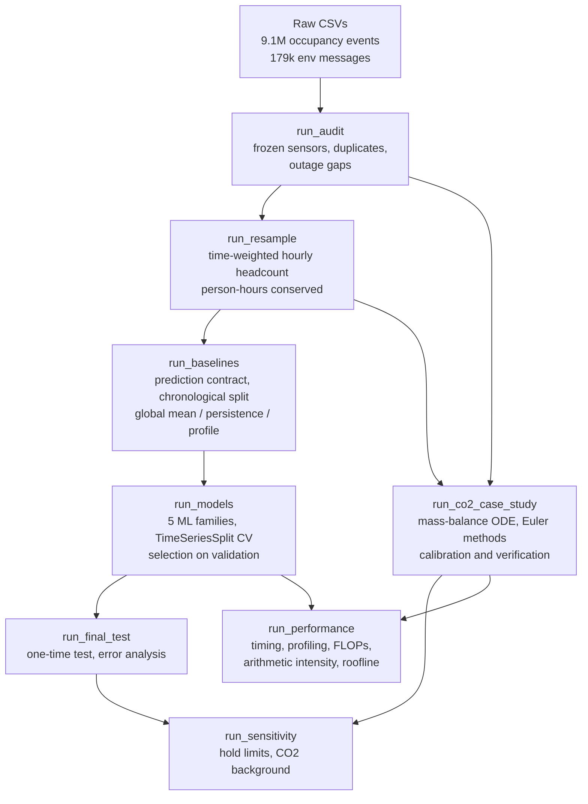

# Occupancy forecasting for HVAC scheduling (MMA3001 project, Dataset 2)

Forecast how many people will be in each monitored space at Monash over the next
hour, so heating, ventilation and air-conditioning (HVAC) can be scheduled for the
people actually present instead of a fixed timetable. A secondary case study tests
whether a CO₂ mass-balance ODE can estimate occupancy from a CO₂ sensor.

**Data:** Monash Smart Infrastructure occupancy and environmental sensors (Dataset 2),
9.1 M occupancy events from 5 spaces (Nov 2023 – Apr 2026) and CO₂ readings from 5
environmental sensors.

**Main result (held-out test, Nov 2025 – Apr 2026):** a small neural network (MLP) predicts
next-hour headcount with MAE 0.283 people vs 0.298 for the best baseline (persistence);
RMSE 0.83 vs 0.98; R² 0.51 vs 0.32. The improvement is statistically significant (day-block
bootstrap 95% CI excludes 0) but modest, and the model under-predicts the busiest hours.

---

## Contents

- [Repository structure](#repository-structure)
- [Installation](#installation)
- [Data](#data)
- [Running the pipeline](#running-the-pipeline)
- [Tutorial: using the package](#tutorial-using-the-package)
- [Inputs and outputs](#inputs-and-outputs)
- [Testing](#testing)
- [Documentation](#documentation)
- [AI use](#ai-use)
- [Licence](#licence)

## Repository structure

```
mma3001-occupancy/
├── occupancy/               # Python package (all reusable code, Google-style docstrings)
│   ├── loaders.py           # read raw CSVs (DuckDB streaming), parse JSON payloads
│   ├── audit.py             # frozen sensors, duplicates, outages, integrity checks
│   ├── resample.py          # event stream -> time-weighted hourly headcount
│   ├── features.py          # prediction contract: calendar + lag features, time split
│   ├── models.py            # baselines: global mean, persistence, seasonal profile
│   ├── ml.py                # ridge, tree, kNN, SVR, MLP pipelines + time-series CV
│   ├── evaluate.py          # MAE, RMSE, bias, R², day-block bootstrap
│   ├── physics.py           # CO₂ mass-balance ODE: forward/backward Euler, fitting
│   └── plotting.py          # shared figure style
├── scripts/                 # one script per pipeline stage (see below)
├── tests/                   # pytest: 68 positive and negative tests
├── results/                 # evidence tables (CSV/JSON) and figures used in the report
├── docs/
│   ├── api/                 # HTML documentation generated by pdoc
│   └── test_report.html     # pytest-html test report
├── data/raw/                # place the supplied data here (not committed, 1.9 GB)
├── data/processed/          # intermediate parquet files (generated, not committed)
├── requirements.txt
└── LICENSE                  # MIT
```

## Installation

Tested with Python 3.13 on Linux (2 vCPU, 7 GB RAM). About 3 GB of free RAM is needed
for the resampling stage.

```bash
git clone <this-repo-url>
cd mma3001-occupancy
python -m venv .venv
source .venv/bin/activate          # Windows: .venv\Scripts\activate
pip install -r requirements.txt
```

## Data

The data is supplied by the unit and is **not** committed (1.9 GB). Copy these three
files from the Dataset 2 download into `data/raw/`:

| File | Contents |
|---|---|
| `5occupancySensor_MayToDec2024_9MRows.csv` | 9,091,732 occupancy state-change events |
| `5EnvSensor_MayToDec2024_180kRows.csv` | 179,447 environmental sensor messages (JSON payloads) |
| `Sensor ID and Locations.xlsx` | sensor register (77 env sensors, 89 occupancy rows) |

Ignore the "Example Data (Do not use)" folder.

## Running the pipeline



Run everything (about 10 minutes):

```bash
python -m scripts.run_all              # add --skip-perf to skip the slow studies
```

or stage by stage, in this order:

| Stage | Command | Main outputs |
|---|---|---|
| 1. Audit | `python -m scripts.run_audit` | `results/audit_*.csv`, `data/processed/occ_events.parquet` |
| 2. Resample | `python -m scripts.run_resample` | `occ_hourly.parquet`, `occ_10min.parquet`, `results/plain_vs_time_weighted.csv` |
| 3. Baselines | `python -m scripts.run_baselines` | `features.parquet`, `results/baselines_val.csv` |
| 4. Models | `python -m scripts.run_models` | `results/cv_results.csv`, `results/model_comparison_val.csv` |
| 5. Final test | `python -m scripts.run_final_test` | `results/final_test*.csv`, `results/figures/test_*.png` |
| 6. CO₂ physics | `python -m scripts.run_co2_case_study` | `results/co2_case_study.json`, `results/figures/co2_*.png` |
| 7. Sensitivity | `python -m scripts.run_sensitivity` | `results/sensitivity_*.csv` |
| 8. Performance | `python -m scripts.run_performance` | `results/performance.json`, `results/figures/roofline.png` |

The model was chosen on the validation period **before** the test set was used; the
decision is recorded in `results/model_selection.md` and in the git history.

## Tutorial: using the package

### 1. Time-weighted headcount from raw events

```python
import pandas as pd
from occupancy.resample import resample_occupancy

events = pd.DataFrame({
    "space": "G.20",
    "t": pd.to_datetime(["2024-04-10 09:00", "2024-04-10 09:50", "2024-04-10 10:00"], utc=True),
    "headcount": [0, 3, 0],
})
hourly = resample_occupancy(events)
print(hourly)   # 09:00 bin: headcount 0.5 (empty 50 min, 3 people for 10 min)
```

### 2. Forecast the next hour

```python
from occupancy.features import build_dataset, time_split
from occupancy.ml import Forecaster, candidates
from occupancy.evaluate import summarise

hourly = pd.read_parquet("data/processed/occ_hourly.parquet")
data = build_dataset(hourly)                                   # lags + calendar features
train, val, test = time_split(data, "2025-07-01", "2025-11-01")
mlp = {c.name: c for c in candidates()}["Neural network (MLP)"]
model = Forecaster(mlp.build({"hidden_layer_sizes": (32,), "alpha": 0.01})).fit(train)
print(summarise(val["headcount"], model.predict(val)))       # MAE, RMSE, Bias, R2
```

### 3. Simulate CO₂ in a room

```python
import numpy as np
from occupancy.physics import simulate

people = np.r_[np.zeros(12), np.full(36, 10), np.zeros(24)]   # 10 people for 6 h, 10-min steps
g, lam = 41.4 / 3600, 0.95 / 3600                              # fitted values (ppm/s/person, 1/s)
excess_co2 = simulate(people, g, lam, h=600, method="backward") # ppm above background
```

## Inputs and outputs

| | Description | Format / units / domain |
|---|---|---|
| **Input** | Occupancy events | `space` (str), `t` (UTC timestamp), `headcount` (int ≥ 0), `status` |
| **Input** | CO₂ readings | `sensorid`, measurement time (Unix s), value (ppm, ~400–2000) |
| **Output** | Hourly occupancy | time-weighted mean headcount (people, real ≥ 0), person-hours, coverage (0–1) |
| **Output** | Forecast | mean headcount of a space over the next hour (people, ≥ 0), issued on the hour |
| **Output** | CO₂ model | fitted air-change rate λ (1/h), CO₂ generation per person g (ppm/h/person), simulated CO₂ (ppm) |

Invalid input handling: missing columns, wrong types, non-timezone-aware times, negative
headcounts or time steps, unsorted events and malformed JSON raise `ValueError`/`TypeError`
with a message; a missing file raises `FileNotFoundError`. Single failed channels inside a
JSON payload are skipped; outage gaps become missing data (not "same as before"); hours with
under 50% trusted coverage are dropped; forecasts are clipped at 0 people.

## Testing

```bash
pytest                                                    # 68 tests
pytest --html=docs/test_report.html --self-contained-html # regenerate the HTML report
```

Tests include known-answer cases (the 0.5-person worked example), conservation of
person-hours, leakage checks on the prediction contract, solver verification against the
analytic solution, first-order convergence, the forward-Euler stability limit, and
manufactured-solution recovery of fitted parameters. The latest report is in
[`docs/test_report.html`](docs/test_report.html).

## Documentation

HTML API documentation is generated from the docstrings with pdoc:

```bash
pdoc -d google --math -o docs/api occupancy
```

Open `docs/api/index.html` in a browser. (GitHub Pages can serve `docs/` if the repository
is public.)

## AI use

Claude (Anthropic) was used responsibly as a coding and analysis assistant, with all output
checked by the student. How it was used is described in Section 7 of the project report.

## Licence

MIT - see [`LICENSE`](LICENSE).
