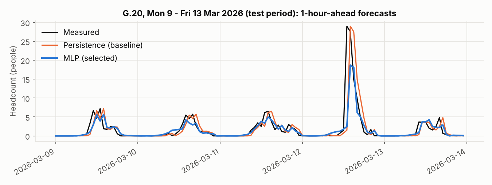
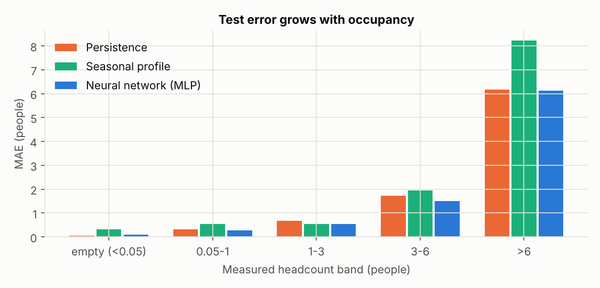
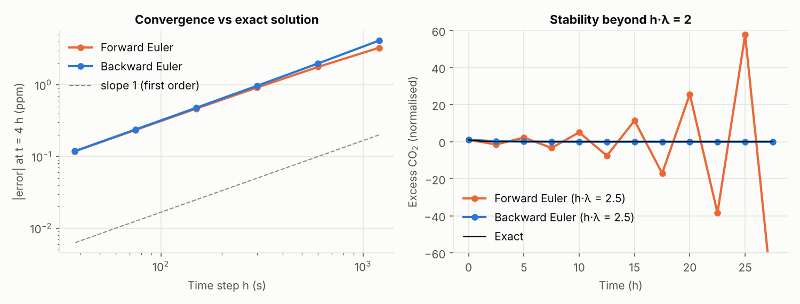
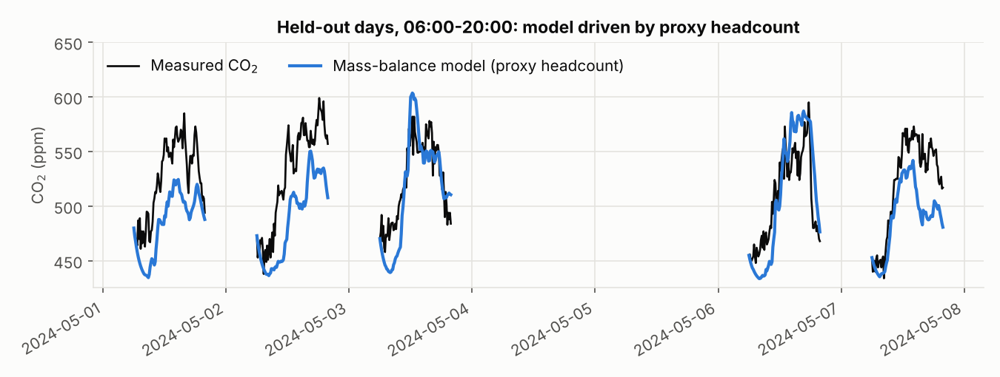
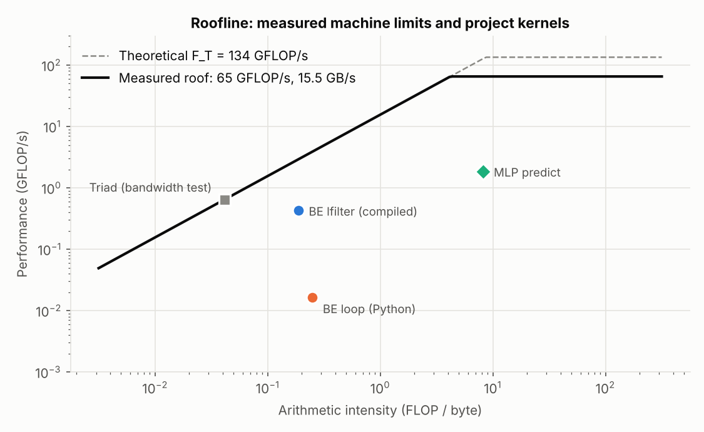
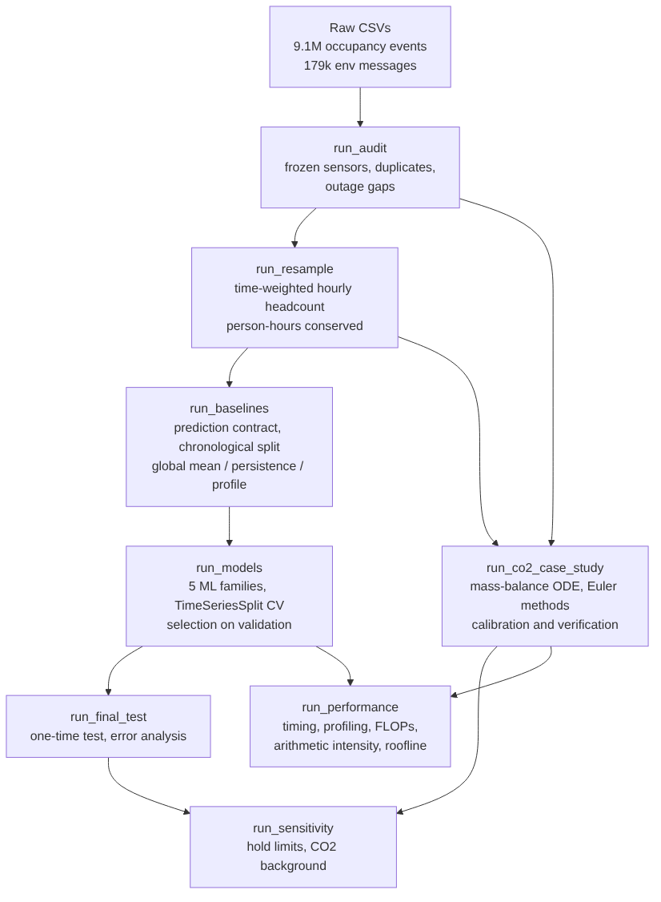
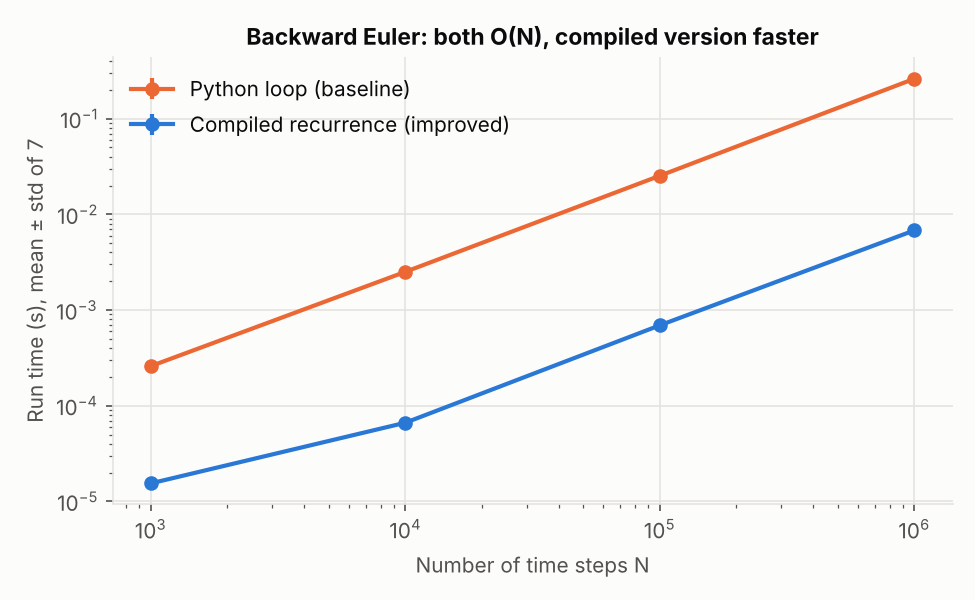

**Summary.** In this project I used Monash occupancy sensor data to predict how many people will be in a room over the next hour, so that heating and cooling (HVAC) could be switched on only when a room is actually going to be used. My best model, a small neural network, predicted the next hour's headcount with an average error of 0.28 people. That is a bit better than the simplest baseline ("next hour will look like the last hour"), at 0.30. I also tested whether a physics model of CO₂ build-up in a room could be used to estimate the number of people from a CO₂ sensor. It gave sensible ventilation rates, but the CO₂ signal was too noisy to replace the occupancy sensors.

## 1. Engineering problem

### Engineering context

HVAC uses a lot of energy in university buildings. Ventilation is sized for the number of people in a room, because people breathe out CO₂. However, most buildings run their HVAC on a fixed timetable (for example 7am to 7pm on weekdays). This means empty rooms are still heated, cooled and ventilated, and busy rooms can end up stuffy.

### The problem being addressed

The question I chose to answer was:

> At the start of each hour, predict the average number of people in each monitored room for the coming hour, using only data that is available at that time.

As a smaller second part, I looked at whether a CO₂ sensor (which is cheaper and more common than a people counter) could be used to estimate occupancy using a mass-balance ODE.

### Why the problem matters

One hour of warning is enough time for an HVAC system to pre-heat or pre-cool a room that will be used, and to turn down one that won't. If the prediction is too high, energy is wasted. If it is too low, people end up in a poorly ventilated room. Because these two mistakes have different consequences, I report whether the model tends to over- or under-predict (the bias), not just its overall error.

### Intended use of the solution

The forecast is meant to be one input to an HVAC schedule for each room. It is not a safety system, so in practice it should be used with a safety margin, especially at busy times (see Section 4).

### Limitations of the selected scope

- The data covers only five spaces, and I could only match two of them (G.20 and G.25 in Building 60) to real room names, because the supplied location spreadsheet is labelled "Incorrect Data".
- I don't know the size, use or timetable of any of the rooms.
- The CO₂ part uses one sensor (room G.38) for about 15 weeks, and treats the room as perfectly mixed (one ODE rather than a PDE over the room).

## 2. Inputs, outputs and data

### The data

Dataset 2 had a lot less usable data than it first appeared. The sensor list names 77 environmental sensors, but only 5 appear in the data, and 3 of those 5 turned out to be broken. So the first job was to check the data carefully before modelling anything.

| File | What it contains | What I used it for |
| --- | --- | --- |
| Occupancy CSV (1.6 GB) | 9,091,732 rows from 5 spaces, Nov 2023 to Apr 2026 | Main forecasting model |
| Environmental CSV (353 MB) | 179,447 messages from 5 sensors, readings stored as JSON text | CO₂ case study |
| Sensor ID and Locations.xlsx | List of sensors and rooms | Finding where sensors are |

An occupancy row is only written when the count in a room changes, so the data is an irregular stream of events rather than regular readings. Each environmental message has two times: when the server received it (`createdate`) and when the reading was actually taken (`time`, inside the JSON).

### Data audit

I wrote checks for each kind of problem (in `occupancy/audit.py`). Each check reports what it found instead of quietly fixing it.

- **Frozen sensors.** A working sensor should almost never send exactly the same message twice, so I counted how many of each sensor's messages were different. Sensors 777, 227 and 241 had only 1, 2 and 3 different messages out of 10,926, 21,363 and 58,908. Sensor 777 was resending a reading taken on 6 May 2023 for the whole of 2024. You can only see this by looking at the measurement time inside the message, not the arrival time.
- **Usable CO₂ sensors.** Sensor 869 (room G.38) worked properly from 29 February to 13 June 2024, then froze. Sensor 326 works but isn't on the sensor list, and its CO₂ is no higher on weekdays than on weekends (a difference of -1.5 ppm, compared with +67 ppm for sensor 869). That suggests nobody uses the space it's in, so I didn't use it.
- **Occupancy rows.** There were 4 exact duplicate rows, which I removed. There were no negative headcounts and no rows where the status and headcount disagreed.
- **Sensor outages.** Rows are only written when something changes, so a long gap could mean "nothing happened" or "the sensor was offline". I decided that if a room had people in it and then went silent for more than 1 hour, or was empty and went silent for more than 24 hours, the time after that should count as missing data. This found 217 outages, about 1,190 hours in total. I tested this choice in Section 5.

### Inputs accepted by the solution

| Input | Format | Units and domain |
| --- | --- | --- |
| Occupancy events | room ID (text), timestamp with time zone, headcount, status | headcount is a whole number of people, 0 or more |
| CO₂ readings | sensor ID, measurement time, value | ppm (readings ranged from 403 to 646) |

### Outputs produced and what they mean

| Output | Meaning and intended use | Units |
| --- | --- | --- |
| Hourly occupancy | Average headcount in each room for each hour, plus person-hours | people (0 or more) |
| Forecast | Predicted average headcount for the next hour, made on the hour, to feed an HVAC schedule | people (0 or more) |
| CO₂ model | Air change rate λ, CO₂ added per person g, and simulated CO₂ | per hour, ppm per hour per person, ppm |

### How invalid, missing or unsupported inputs are handled

- Missing columns, wrong data types, timestamps without a time zone, negative headcounts, events out of order, a time step of zero or less, and broken JSON all raise a `ValueError` or `TypeError` with a message. A missing file raises `FileNotFoundError`.
- If one reading inside a JSON message has failed (sensor 326 sometimes sends `"errorCode": 4` instead of a formaldehyde value), only that reading is skipped and the rest of the message is kept.
- Outage time is treated as missing, and any hour that is less than half covered by trusted data is dropped.
- A room the model hasn't seen before falls back to the average pattern across all rooms.
- The inputs and outputs of every function are described in the docstrings, which are turned into HTML documentation with pdoc (`docs/api`).

## 3. Computational approach

The code is a Python package (`occupancy/`) with one script for each stage. The whole thing can be re-run with `python -m scripts.run_all`, and a flowchart is in Appendix A.1.

### 3.1 Turning events into hourly values (numerical integration)

**How it works.** Between two events the headcount stays the same, so headcount over time is a step function. The correct average for an hour is the area under that step function divided by the length of time covered:

$$\bar{N} = \frac{\int N(t)\,dt}{\int dt} = \frac{\sum_i N_i\,\Delta t_i}{\sum_i \Delta t_i}$$

Because the function is made of flat steps, this sum gives the exact integral. The top of the fraction is person-hours.

**Why I chose it.** The obvious alternative, averaging the rows in each hour, gives the wrong answer. Busy periods create lots of rows because the count keeps changing, while empty periods create very few. Across the data, the simple row average overestimated occupancy by 1.4 to 2.1 times in a typical hour, and by 12 to 20 times in one hour out of ten. For example, at 9am on 10 April 2024 in G.20, the row average was 3.6 people but the real time-weighted average was 0.3.

**Result.** 84,422 hourly values across the five rooms. 95 hours were dropped because less than half the hour had trusted data.

### 3.2 What the model is allowed to know (prediction contract)

Following the Week 5.6 notes, I defined exactly what the model can use. A forecast made at the start of hour τ predicts the average for τ to τ+1 hour, and can only use:

- calendar information: hour of day and day of week (in Melbourne time), and whether it's a weekend;
- past headcounts only: 1, 2 and 3 hours ago, the same hour yesterday (24 h), the same hour last week (168 h), and the average of the previous 24 hours;
- which room it is.

Hour and day are converted using sine and cosine so that 11pm and midnight end up close together, the same way positions on a clock face are. Past values are taken from a complete hourly timeline, so if an hour is missing because of an outage, the lag is also missing. This avoids accidentally using the wrong hour. This left 82,215 usable rows.

### 3.3 Models compared

| Model | How it predicts | Why I included it |
| --- | --- | --- |
| Global mean | Always predicts the training average | The simplest possible baseline |
| Persistence | Next hour = last hour | Strong simple baseline because occupancy changes slowly |
| Seasonal profile | Average for this room, weekday and hour | Captures the usual weekly routine |
| Ridge regression (Week 5.1) | Linear model with a penalty on large weights | Simple and easy to interpret |
| Decision tree (5.2) | Splits the data into groups with yes/no questions | Non-linear but still interpretable |
| k-nearest neighbours (3.6) | Averages the most similar past hours | Interpolates between similar situations |
| SVR with RBF kernel (5.3) | Kernel regression, trained on 5,000 rows | Smooth non-linear model |
| Neural network (MLP, 5.4) | One hidden layer of 32 neurons | Can combine "what's happening now" with "what usually happens" |

**Settings.** All scaling and encoding is done inside a scikit-learn `Pipeline`, so it is only learned from training data. I chose each model's settings (for example tree depth, number of neighbours, network size) using `TimeSeriesSplit` cross-validation with 4 folds and a one-day gap, on the training period only. Negative predictions are set to zero, since you can't have fewer than zero people.

### 3.4 CO₂ mass-balance model (ODE)

**How it works.** If the room is treated as one well-mixed volume (Week 7.2), the CO₂ concentration changes because people add CO₂ and ventilation removes it:

$$V\frac{dC}{dt} = G\,N(t) - Q\,(C - C_b) \quad\Longrightarrow\quad \frac{dy}{dt} = g\,N(t) - \lambda\,y$$

where y = C - C~b~ is the CO₂ above the background level, g = G/V is the CO₂ added per person and λ = Q/V is the air change rate.

**Assumptions.** The air is perfectly mixed, the background CO₂ is constant (I used 429 ppm, the 5th percentile of the readings), every person breathes out the same amount of CO₂, and the number of people is constant within each 10-minute step. Only g and λ can be found from CO₂ data. The room volume, airflow and CO₂ per person can't be separated, because only their ratios appear in the equation.

**Solvers.** I solved the ODE with forward Euler, y~k+1~ = (1 - hλ)y~k~ + hgN~k~, and with backward Euler, y~k+1~ = (y~k~ + hgN~k~)/(1 + hλ). Because the equation is linear, backward Euler only needs one division per step.

**Fitting the parameters.** I found λ at night from how quickly CO₂ dropped over 75 nights when the room was empty, by fitting a straight line to ln(C - C~b~) with least squares. I then found the daytime λ and g from March and April weekdays, by trying a range of λ values and solving for the best g each time.

**Which room's occupancy to use.** No CO₂ sensor is in the same room as an occupancy sensor, so I had to use another room's headcount as a stand-in. I compared all five rooms after removing the normal weekly pattern from both signals. Space 3e5a matched best (correlation 0.61) but has no data in March or April, when I fitted the model. The next best was space 941f (0.50), so I used that. This is a big assumption, and I come back to it in Section 4.

## 4. Validation method and results

### What was validated

1. The **forecast**: does it predict future occupancy better than the baselines?
2. The **numerical methods**: are the resampling and the ODE solvers working correctly? (verification)
3. The **CO₂ model**: does it match real CO₂ measurements? (validation)

### Why this validation method is appropriate

I split the data by time: training from Nov 2023 to June 2025 (54,445 room-hours), validation from July to October 2025 (11,676) and testing from November 2025 to April 2026 (16,094). I didn't use a random split. Occupancy in one hour is very similar to the hour before (persistence alone gets R² = 0.42), so with a random split the model would have seen the hours either side of each test hour, which makes results look better than they really are. Occupancy also changes over time (2024 was busier than 2026), and a time split tests the model the same way it would be used: predicting the future from the past.

### Metrics and acceptance criteria

- **MAE** (average error, in people) is my main metric because it's easy to understand.
- **RMSE** gives extra weight to big misses, which matter most for ventilation.
- **Bias** shows whether the model over- or under-predicts.
- **R²** is included for completeness.

To be accepted, a model had to beat persistence on the validation data, with a 95% bootstrap confidence interval that didn't include zero. This is the bootstrap from Week 5.5, except that I resampled whole days instead of single hours, because errors in the same day are related to each other. I also looked at errors by how busy the room was, by room, and during weekday working hours.

### Did validation influence model selection?

Yes. Cross-validation chose the settings within each model type, and the validation period chose between model types. The top three were the SVR (MAE 0.334), the decision tree (0.336) and the neural network (0.337). The confidence intervals showed these differences could just be chance, so I used RMSE to break the tie, which picked the neural network (RMSE 0.836, against 0.877 for the tree and 0.958 for the SVR). I saved this decision in git (`results/model_selection.md`) **before** looking at the test data, so the test result couldn't affect the choice.

### Results on the test data (used once)

| Model | MAE (people) | RMSE | Bias | R² | MAE, weekdays 8am-6pm |
| --- | --- | --- | --- | --- | --- |
| **Neural network (selected)** | **0.283** | **0.828** | +0.016 | **0.510** | **0.552** |
| Decision tree | 0.282 | 0.846 | +0.016 | 0.488 | 0.566 |
| Persistence | 0.298 | 0.977 | 0.000 | 0.317 | 0.591 |
| Seasonal profile | 0.506 | 1.050 | +0.177 | 0.212 | 0.944 |
| Global mean | 0.747 | 1.202 | +0.217 | -0.034 | 0.917 |

The models ranked the same way as on the validation data, which suggests the choice wasn't just lucky. The neural network beat persistence, but only by a small amount: 5% on MAE and 15% on RMSE.

{width=88%}

Both models are about an hour late when people arrive, and neither saw the 29-person spike on 12 March coming. The model has no information about class timetables, so it can't know a big class is about to start.

{width=62%}

Errors get bigger as rooms get busier, and the neural network tends to under-predict busy hours: by 1.15 people on average when 3 to 6 people were present, and by 5.4 people when more than 6 were present (77 hours). This is the model's main weakness, because under-predicting means under-ventilating at the busiest times. By room, it beat persistence in three of the four rooms in the test period, but was slightly worse in G.25 (0.242 against 0.221). Only 0.006% of test hours were busier than anything in the training data, so the model was rarely outside the range it learned from.

**What this means for HVAC.** On weekdays between 7am and 7pm, there were 5,792 room-hours in the test period, and 2,285 of them (39%) were empty. A fixed timetable heats and cools all of them. If HVAC were turned down whenever the forecast was below 0.5 people:

- persistence would turn down 1,869 of the empty hours, but would also wrongly turn down 582 of the 3,507 occupied hours (17%);
- the neural network would turn down 1,503 of the empty hours, and wrongly turn down only 222 occupied hours (6%).

So the neural network saves a bit less energy but makes far fewer mistakes that would leave people in an unventilated room.

### Verification of the numerical methods

- **Resampling.** The total person-hours before and after splitting into hours matched to a relative difference of 1.2 × 10⁻¹⁶, which is machine precision. A hand-worked example (empty for 50 minutes, then 3 people for 10 minutes, which should give 0.5) came out exactly right.
- **No data leakage.** On a made-up dataset, every lag feature was exactly the right number of hours behind, and no feature equalled the value being predicted.
- **ODE solver.** Both Euler methods matched the exact solution for a constant number of people, y(t) = y~ss~ + (y~0~ - y~ss~)e^-λt^. Halving the time step halved the error, which is what's expected for a first-order method. With hλ = 2.5, forward Euler oscillated and blew up while backward Euler stayed stable, which matches the theory.
- **Parameter fitting.** When I generated fake data with known values of g and λ, the fitting code recovered them exactly (a manufactured solution).

{width=86%}

### Validation of the CO₂ model

The fitted values make physical sense. At night λ = 0.041 per hour, meaning the ventilation is basically off, and during the day λ = 0.95 per hour, about one air change per hour, which is normal for a mechanically ventilated room. The fitted g = 41 ppm per hour per person suggests a room of about 450 m³, assuming each person breathes out about 0.0052 L/s of CO₂. With 10-minute steps, hλ = 0.16, which is well under the stability limit of 2, so even forward Euler is stable here.

On 31 weekdays in May and June that weren't used for fitting, the model had a CO₂ error (RMSE) of 38 ppm, compared with 82 ppm if people are ignored (R² = 0.39).

{width=82%}

The model drops too low before 8am, because it assumes the HVAC runs at the daytime rate all day when it actually switches on in the morning. That is a problem with the model's assumptions, not with the solver. I also tried working backwards from CO₂ to headcount using central differences (Week 7.1). The result followed the real headcount (correlation 0.63) but had an average error of 0.67 people. It jumped around by about 1.3 people every 10 minutes, because taking derivatives of noisy data amplifies the noise (about 8 ppm).

### What validation cannot establish

- How well the model would work in other buildings or types of rooms, since there are only five spaces.
- What happens if the timetable changes, or in seasons not in the data.
- Whether the occupancy sensors themselves count correctly, since there is nothing independent to compare them to.
- G.38's true occupancy. The CO₂ results rely on using another room's headcount as a stand-in, so they test the method rather than the room.

## 5. Comparison and optimisation

### 5.1 Alternative solutions compared

| Approach | Validation MAE | CV MAE (mean ± std) | Training time | Prediction time | How interpretable |
| --- | --- | --- | --- | --- | --- |
| Neural network | 0.337 | 0.371 ± 0.074 | 4.0 s | 0.02 s | Low |
| Decision tree | 0.336 | 0.374 ± 0.084 | 0.28 s | 0.01 s | High |
| SVR (5,000-row sample) | 0.334 | 0.391 ± 0.114 | 0.42 s | 1.1 s | Low |
| k-nearest neighbours | 0.343 | 0.398 ± 0.090 | 0.04 s | 1.1 s | Medium |
| Ridge regression | 0.350 | 0.381 ± 0.077 | 0.05 s | 0.01 s | High |
| Persistence | 0.364 | - | - | instant | High |
| CO₂ physics (working backwards) | 0.67\* | - | - | - | High |

\*Compared against a different room's headcount, so not a fair comparison.

The variation between cross-validation folds (about ±0.07 to ±0.11) is bigger than the differences between models, so all the ML models perform fairly similarly. SVR and k-NN are slow at prediction time because they compare every new point with the stored training data. SVR also gets very slow to train as the data grows (roughly n² to n³), which is why I trained it on a sample. I didn't use a Gaussian process for the same reason: with 54,000 training rows its matrix would need about 23 GB of memory. I chose the neural network because it had the lowest RMSE and predicts quickly. The decision tree would be a good alternative if being able to explain the model mattered more.

### 5.2 Sensitivity analysis

I tested the two main choices that I had to make by judgment, without using the test data (full table in Appendix A.2).

- **Outage limit.** Changing the 1-hour limit for occupied rooms anywhere from 0.5 to 4 hours changed total person-hours by less than 0.6%, and the neural network's validation MAE only moved between 0.335 and 0.341. So the results don't depend much on this choice. Making the empty-room limit stricter (12 hours) threw away about 4,000 weekend hours that were genuinely quiet, so I kept 24 hours. The neural network beat persistence under every setting.
- **CO₂ background level.** Changing C~b~ from 422 to 445 ppm changed g by only about ±4%, but changed the daytime λ by about ±13% (0.85 to 1.10 per hour). So λ is the most sensitive parameter in the physics model. A higher background gave a better fit, but it sat above many of the overnight readings, which doesn't make physical sense, so I kept my original choice.

### 5.3 Performance analysis

**Machine limits.** I ran everything on a shared cloud machine with 2 cores at 2.1 GHz. Using the formula from Week 2.1, the theoretical peak is F~T~ = 2 cores × 2.1 GHz × 32 FLOPs per cycle = 134 GFLOP/s. I couldn't install likwid, so I measured the limits myself:

- a large matrix multiplication reached 65 GFLOP/s;
- a triad test (A = B × C + D) on arrays too big for the cache reached 15.5 GB/s of memory bandwidth;
- this gives a machine balance of 4.2 FLOPs per byte.

A first run gave 61 GFLOP/s and 13.4 GB/s, which shows how much timings vary on a shared machine. So every timing below is the mean ± standard deviation of 7 repeats with `timeit`.

**Arithmetic intensity of my code.**

| Code | FLOPs / bytes per step | Arithmetic intensity | Time | Speed | % of roofline limit |
| --- | --- | --- | --- | --- | --- |
| Backward Euler, Python loop (10⁶ steps) | 4 / 16 | 0.25 | 244 ± 0.6 ms | 0.016 GFLOP/s | 0.4% |
| Backward Euler, `lfilter` (10⁶ steps) | 3 / 16 | 0.19 | 7.0 ± 1.0 ms | 0.43 GFLOP/s | 15% |
| Neural network prediction (117k rows) | 1,120 / 136 | 8.2 | 70 ± 0.9 ms | 1.86 GFLOP/s | 2.9% |

{width=62%}

**Baseline vs improved solver.** The ODE solver has a low arithmetic intensity (0.19 to 0.25), so in theory it should be limited by memory bandwidth. In practice the Python loop only reached 0.4% of that limit. Using line_profiler, I found that 68% of the time was spent on the update line and 32% on the `for` loop itself, about 0.7 microseconds per step. So the bottleneck was Python's overhead, not the hardware. Backward Euler for this equation is just "each new value = a × previous value + b × input", and SciPy's `lfilter` runs exactly that loop in C. It gives identical answers (tests agree to 10⁻¹²) and is 35 to 38 times faster, while still scaling linearly with the number of steps (Appendix A.3). It's still below the roofline because each step depends on the one before, so it can't be vectorised. The neural network has a higher arithmetic intensity (8.2), so it should be compute-bound, but it only reaches 2.9% of peak because its layers are small and scikit-learn adds overhead to each call.

**Precision.** Using float32 instead of float64 changed the solver's results by at most a relative 4 × 10⁻⁷ (0.0003 ppm), which is far smaller than the 8 ppm sensor noise. It wasn't any faster, though, because the loop is limited by each step waiting for the last, not by the amount of data. So I kept float64.

**Whole pipeline.** Scalene showed the slowest step, resampling (73.5 s), spends 67% of its time in pandas/NumPy, 28% allocating memory and 4% in Python, peaking at 2.5 GB. It only runs once, so I left it as is.

## 6. Limitations and lessons learned

### Limitations

- **Busy hours are under-predicted.** If this was used for real, it would need a safety margin, or HVAC could use whichever is higher out of the forecast and the current count during class times.
- **No timetable information.** The model can't predict a big class starting if it has never seen it coming.
- **Small sample.** Five rooms, only two identified, with unknown sizes and uses, all from one sensor device.
- **The occupancy sensors are assumed to be correct.** There was no independent count to check them against.
- **Judgment calls.** The outage limits are my own choices, although the sensitivity test showed they don't change the conclusions.
- **Simplified CO₂ model.** It assumes perfect mixing, one daytime ventilation rate, a constant background, and uses another room's headcount.

### Lessons learned

1. **Check the data first.** Most of the listed sensors were missing or broken, and the frozen ones only showed up in the measurement times.
2. **How you average matters.** Averaging rows instead of time overestimated occupancy by up to 20 times.
3. **Simple baselines are hard to beat.** Persistence already captured most of the pattern, and the ML models only added 5 to 15% on top. It's better to report that honestly than to oversell the model.
4. **Protect the test set.** Choosing the model before looking at the test data, and saving that choice in git, means the test result can be trusted.
5. **Verification and validation are different.** The solver was verified exactly, but the model was still wrong before 8am, because of an assumption in the model rather than a mistake in the solver.
6. **Profile before optimising.** The solver looked memory-limited on paper, but profiling showed Python overhead was the real problem.

### Improvements I would make

- Add the university timetable and public holidays as inputs.
- Train the model so that it deliberately leans towards over-predicting, since under-ventilating is the worse mistake.
- Put a CO₂ sensor in the same room as an occupancy sensor to test the physics model properly, and fit separate ventilation rates for when the HVAC is on and off.

## 7. AI use and reflection

### Which AI tools were used

Claude (Anthropic), model Claude Opus 5.5, through claude.ai, on 24 and 25 October 2026.
### What it was used for and how much it contributed

| Task | AI contribution | What I did |
| --- | --- | --- |
| Reading the brief, datasets and unit notes; suggesting a dataset | High | Chose Dataset 2 after asking how it knew the sensors were broken, and checked the raw data myself |
| Writing the data and modelling code | High (wrote the code) | Set the requirements, reviewed the outputs and ran the pipeline |
| Choosing methods | Medium (suggested options) | Chose the 1-hour forecast, the overall scope, and asked to keep it within the unit's content |
| Tests, documentation and performance study | High | Checked the tests used known answers, reviewed every figure |
| Drafting the report | High (first draft) | Rewrote it and checked the numbers against `results/` |

### Why I used AI for these tasks

I had about two days for the project. Using AI for the code meant I could spend my time understanding and checking the methods. I asked it to explain every step before building it, which is also how I prepared to explain the work in the interview without AI.

### How I checked what the AI produced

Tests with known answers (the 0.5-person example, the exact ODE solution, manufactured data), conservation checks, looking at the raw data, looking at every figure, and checking claims against the source files.

### Errors and unhelpful suggestions from the AI

- It called sensor 326 an "outdoor" sensor, but the sensor isn't on the list at all, so its location is unknown.
- Its first JSON reader threw away a whole message if one reading had an error, losing 29,043 CO₂ readings. I noticed because the warning count matched sensor 326's message count exactly.
- Its resampling code assumed the wrong time units, which put all the data in 1970, and it also stretched each sensor's last reading 24 hours into the future. Unit tests caught both.
- One of its comparisons partly tested a model on its own training data.
- It installed a version of a profiler released the day before, which didn't match the unit notes, so we used an older version.
- When I asked for a longer git history, it refused to fake the commit dates and instead split the real work into smaller commits. While doing this, it accidentally committed 64 MB of data files, which we found because the zipped repo was 110 MB, and removed before anything was uploaded.
- At the end I asked for a full review to make sure everything was within the unit's scope. This replaced a database tool it had used (DuckDB, not taught in the unit) with pandas, giving identical results. It also made two numbers it had quoted from early exploration reproducible from the code, which corrected one of them (0.53 to 0.50).

### Decisions that remained my responsibility

The dataset, the forecast horizon, the scope, accepting the outage rule after the sensitivity test, accepting the neural network based on the tie-break, asking for the scope review, and deciding what to claim in this report.

### How AI affected my understanding and workflow

Having each step explained before it was built helped me follow the reasoning, for example why a random split leaks information, or why forward Euler needs hλ < 2. The main risk was trusting it too much: several of its mistakes didn't cause any error messages and were only caught because a test failed or a number looked suspicious. Disclosing AI use doesn't replace checking its work, and I'm responsible for everything in this project.

## 8. References

1. Monash University (2026). *MMA3001 Numerical Methods and Machine Learning*, unit notes Weeks 1.1 to 11.5.
2. Monash Smart Infrastructure (2026). *Dataset 2: Occupancy and Environmental Sensor Data* and *Sensor ID and Locations*, supplied for MMA3001.
3. Pedregosa, F. et al. (2011). Scikit-learn: Machine learning in Python. *Journal of Machine Learning Research*, 12, 2825-2830.
4. Virtanen, P. et al. (2020). SciPy 1.0: fundamental algorithms for scientific computing in Python. *Nature Methods*, 17, 261-272.
5. Williams, S., Waterman, A. and Patterson, D. (2009). Roofline: an insightful visual performance model for multicore architectures. *Communications of the ACM*, 52(4), 65-76.
6. McCalpin, J. D. (1995). Memory bandwidth and machine balance in current high performance computers. *IEEE TCCA Newsletter*.
7. Persily, A. and de Jonge, L. (2017). Carbon dioxide generation rates for building occupants. *Indoor Air*, 27(5), 868-879.
8. Berger, E. D., Stern, S. and Pizzorno, J. A. (2023). Triangulating Python performance issues with Scalene. *USENIX OSDI*.
9. Anthropic (2026). Claude Opus 5.5, accessed through claude.ai, 24-25 October 2026.

GitHub repository: **[add link before submission]**. It includes the HTML code documentation (`docs/api`) and the test report (`docs/test_report.html`).

## Appendix A

**A.1 Pipeline.** The stages of the project and how data flows between them (also in the README).

{width=62%}

**A.2 Sensitivity to the outage limits** (validation data only).

| Outage limit (occupied / empty) | Person-hours | Rows for modelling | Validation MAE, persistence | Validation MAE, neural network |
| --- | --- | --- | --- | --- |
| 0.5 h / 24 h | 58,830 | 81,800 | 0.364 | 0.341 |
| **1 h / 24 h (used)** | 59,040 | 82,215 | 0.364 | 0.337 |
| 2 h / 24 h | 59,134 | 82,536 | 0.364 | 0.337 |
| 4 h / 24 h | 59,174 | 82,661 | 0.364 | 0.335 |
| 1 h / 12 h | 59,027 | 78,167 | 0.376 | 0.350 |
| 1 h / 48 h | 59,041 | 83,055 | 0.363 | 0.343 |

**A.3 Scaling study.** Mean ± standard deviation of 7 repeats. Both versions of the solver scale linearly with the number of steps. The compiled version is 17 times faster for 1,000 steps (where the time is mostly function-call overhead) and 35 to 38 times faster for 10,000 steps or more.

{width=70%}
